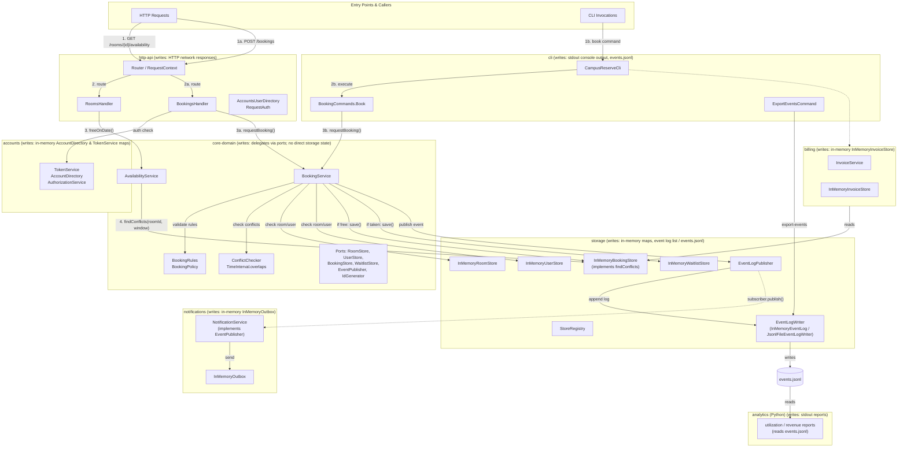

# BOUNDARIES.md

One section per milestone. Fill them in in order (the sketch before you write
anything about it, the copies next, the proposal last).

Draw Milestone 1's sketch from the code. A TA may ask where each arrow came
from.

Keep it short and specific. Point at modules, files, and callers.

---

## Milestone 1: The architecture as built

**The sketch.**

**What each module writes:**
- `core-domain`: Holds no persistent state; delegates all state writes to ports (`BookingStore.save`, `WaitlistStore.save/remove`, `EventPublisher.publish`).
- `storage`: Writes to in-memory store maps (`InMemoryBookingStore`, `InMemoryWaitlistStore`, `InMemoryRoomStore`, `InMemoryUserStore`), appends to in-memory event list (`InMemoryEventLog`) or writes lines to `events.jsonl` (`JsonlFileEventLogWriter`).
- `notifications`: Writes queued notification records to `InMemoryOutbox`.
- `accounts`: Writes in-memory account and token maps in `AccountDirectory` and `TokenService`; syncs accounts into domain `UserStore`.
- `billing`: Writes generated invoice records to in-memory map in `InMemoryInvoiceStore`.
- `http-api`: Writes HTTP network responses to socket (no persistent data store).
- `cli`: Writes formatted text to stdout; `ExportEventsCommand` writes `events.jsonl` to disk.
- `analytics`: Reads `events.jsonl`; writes formatted reports to stdout (does not write persistent stores or events).

**Where your sketch and `ARCHITECTURE.md` disagree.**
1. `ARCHITECTURE.md` completely omits the availability request path (`GET /rooms/{roomId}/availability`) and `AvailabilityService`, whereas our sketch charts it from `RoomsHandler` through `AvailabilityService` to `BookingStore.findConflicts`.
2. `ARCHITECTURE.md` asserts that all conflict checking routes through `ConflictChecker ---> TimeInterval.overlaps` ("the only overlap implementation"), whereas our sketch shows a second overlap predicate implemented directly inside `storage`'s `InMemoryBookingStore.findConflicts`.
3. `ARCHITECTURE.md` draws a direct dependency arrow from `EventLogPublisher (storage)` to `NotificationService (outbox)`, whereas our sketch shows `storage` decoupled from `notifications` (dispatched via the `EventPublisher` port wired inside `http-api`).

**How you decided which one is right.**
1. **Availability path**: In `http-api/src/main/java/edu/cmu/cs214/campusreserve/http/RoomsHandler.java` (lines 38, 71–93), `router.get("/rooms/{roomId}/availability", ...)` routes availability requests to `RoomsHandler.availability`, which calls `AvailabilityService.freeOnDate` (`core-domain/src/main/java/edu/cmu/cs214/campusreserve/core/service/AvailabilityService.java`, line 41), which queries `BookingStore.findConflicts`. Wiring is verified in `http-api/src/main/java/edu/cmu/cs214/campusreserve/http/CampusReservePlatform.java` (lines 50, 156).
2. **Second conflict predicate**: In `storage/src/main/java/edu/cmu/cs214/campusreserve/storage/InMemoryBookingStore.java` (lines 55–64), `findConflicts` compares interval bounds directly (`booking.interval().start().isBefore(windowEnd) && windowStart.isBefore(booking.interval().end())`) without calling `TimeInterval.overlaps` or `ConflictChecker`. This second predicate is explicitly pinned by unit tests in `storage/src/test/java/edu/cmu/cs214/campusreserve/storage/FindConflictsTest.java`.
3. **Decoupled notification subscriber**: `storage/pom.xml` has no dependency on `notifications`. In `storage/src/main/java/edu/cmu/cs214/campusreserve/storage/EventLogPublisher.java` (lines 22, 39–45), `EventLogPublisher` references only a generic `List<EventPublisher>` (from `core-domain/src/main/java/edu/cmu/cs214/campusreserve/core/ports/EventPublisher.java`). The subscriber connection to `NotificationService` is wired exclusively in `http-api/src/main/java/edu/cmu/cs214/campusreserve/http/CampusReservePlatform.java` (line 58: `stores.subscribe(notifications);`).

---

## Milestone 2: Run it as copies

**Your stack.**
- Command to bring up two copies: `docker compose up -d --scale api=2 proxy`
- Distinct `X-Upstream` values seen: 2 distinct values (`172.18.0.2:8080` and `172.18.0.3:8080`), confirming that traffic was distributed across both backend copies.

### Finding 1: tokens

**The claim.**
A bearer token works on any request, whichever copy answers it.

**The script and its result.**
- Script file: `load/tokens.js`
- Threshold: `'token_works_on_any_copy': ['rate == 1.0']`
- Result: Ran 20 requests against `http://proxy/bookings` using a valid token issued by `api-1`. Out of 20 requests, 11 requests answered by `172.18.0.3:8080` (`api-1`) returned HTTP 200 OK, while 9 requests answered by `172.18.0.2:8080` (`api-2`) returned HTTP 401 Unauthorized (`{"error":"invalid_token"}`). The success rate was 55%, failing the threshold with exit code 99.

**Why, from the code.**
The `TokenService` class (`accounts/src/main/java/edu/cmu/cs214/campusreserve/accounts/TokenService.java`) keeps tokens in a private, in-memory `Map<String, StoredToken> tokens = new ConcurrentHashMap<>()`. Each container runs its own `CampusReserveServer`, which constructs a separate `CampusReservePlatform` holding its own isolated `TokenService` with randomized tokens (`TokenMinter.random()`). When `proxy` routes a request with `api-1`'s token to `api-2`, `api-2`'s `RequestAuth` checks its local `TokenService`, finds no match, and aborts with a 401 Unauthorized. Found by tracing `BookingsHandler` $\to$ `RequestAuth.require` $\to$ `AuthorizationService` $\to$ `TokenService`.

**The kind of problem.**
In-memory session state / local unshared authentication state in horizontal replicas (violation of the statelessness boundary required for replica substitution).

### Finding 2: bookings

**The claim.**
A room slot is booked at most once across the platform.

**The script and its result.**
- Script file: `load/bookings.js`
- Reaching each copy directly: The script sends one booking to `http://f26-lab09-api-1:8080/bookings` with `TOKEN_1`, and the identical room and time slot request (`r-1`, `2026-10-31T14:00:00Z` to `15:00:00Z`) directly to `http://f26-lab09-api-2:8080/bookings` with `TOKEN_2`. It must reach each copy directly because sending both requests through `http://proxy` would be caught by Finding 1 (if proxy sends token 1 to copy 2, copy 2 rejects with 401 before reaching the booking conflict logic). Direct access isolates the booking conflict check.
- Threshold: `'slot_booked_at_most_once': ['rate == 1.0']` and `'confirmed_bookings_count': ['count <= 1']`.
- Result: Both copies returned HTTP 201 Created with `outcome: "confirmed"` (`api-1` created booking `bk-afdc625a...` and `api-2` created booking `bk-8fe0bad9...`). Two confirmed bookings were created for the exact same slot, yielding a `0.00%` rate on `slot_booked_at_most_once` and a count of 2 on `confirmed_bookings_count`, failing the threshold with exit code 99.

**Why, from the code.**
`InMemoryBookingStore` (`storage/src/main/java/edu/cmu/cs214/campusreserve/storage/InMemoryBookingStore.java`) stores bookings in a local `ConcurrentHashMap` (`records` in `InMemoryRecordStore`). Each copy initializes its own in-memory store in `CampusReservePlatform.java` (`stores = StoreRegistry.inMemory()`). When `api-1` processes the booking, it checks its local store, sees the room is free, and stores the booking. When `api-2` receives the request for the same slot, its local store has no record of `api-1`'s booking, so `conflictChecker.hasConflict` evaluates to false, and `api-2` also confirms the booking. Neither copy shares state or coordinates with the other.

**The kind of problem.**
Partitioned mutable state / split-brain / inconsistent replica state (violation of the system invariant: at most one confirmed booking per room slot).

### What you checked

One thing your agent proposed that you checked:
- **What it proposed**: In Milestone 1, the agent proposed that `storage` implements its own interval overlap comparison inside `InMemoryBookingStore.findConflicts`, violating `ARCHITECTURE.md`'s and `AGENTS.md` Rule 3's invariant that `TimeInterval.overlaps` is the sole overlap predicate in the codebase.
- **How you checked it**: Inspected `storage/src/main/java/edu/cmu/cs214/campusreserve/storage/InMemoryBookingStore.java` lines 55–64 and confirmed that `findConflicts` compares interval bounds directly (`booking.interval().start().isBefore(windowEnd) && windowStart.isBefore(booking.interval().end())`) without invoking `TimeInterval.overlaps`. Then verified `storage/src/test/java/edu/cmu/cs214/campusreserve/storage/FindConflictsTest.java` to confirm unit tests specifically pin this independent storage predicate.
- **What came of it**: Confirmed that `storage` indeed maintains an undocumented second overlap predicate that bypasses `core-domain`'s `ConflictChecker` entirely.

---

## Milestone 3: One boundary

Take one problem from Milestone 1 or 2 and propose the boundary that fixes it.

**Problem chosen:** Finding 2 (Concurrent duplicate bookings across replicas).
- *Location and mechanism:* In `core-domain/src/main/java/edu/cmu/cs214/campusreserve/core/service/BookingService.java` (lines 112–125), `BookingService.requestBooking()` executes a non-atomic read-check-write sequence: it queries `bookings.findActiveByRoom(roomId)`, runs in-memory `conflictChecker.hasConflict(...)`, and then calls `bookings.save(booking)`. When CampusReserve runs as multiple copies behind a load balancer, each copy operates on its own private `InMemoryBookingStore` map without synchronization, allowing concurrent or interleaved requests for the same room and slot to both confirm and persist.

**The boundary.**
- **The port:** Add `boolean saveIfFree(Booking booking)` to `core/ports/BookingStore.java` in `core-domain`, replacing the unchecked `void save(Booking booking)` on the reservation creation path.
- **What it promises:** The port promises linearizable, atomic conflict detection and reservation: it checks for active conflicting bookings on `booking.roomId()` over `booking.interval()` and persists the booking if and only if no conflict exists in a single atomic transaction, returning `true`. If an overlapping active booking already exists, it aborts without persisting and returns `false`.
- **Which side implements it:** `storage` implements it. In a multi-copy production deployment, a shared `JdbcBookingStore` enforces this atomically using a shared relational database transaction with exclusion constraints (e.g., PostgreSQL `EXCLUDE USING gist (room_id WITH =, interval_range WITH &&)`). For tests and local CLI, `InMemoryBookingStore` implements it using an atomic `compute()` or synchronized lock over the room's booking list.
- **What moves and what stays:**
  - *What moves:* Authoritative write-time conflict detection moves across the port boundary into `storage` (enforced at the transactional datastore level).
  - *What stays:* Business validation rules (room eligibility, duration limits, 15-minute slot alignment, opening hours, room capacity, advance booking limits, and user active booking caps) stay in `core-domain` (`BookingService`, `BookingRules`, `BookingPolicy`). Preliminary availability reads for user UI queries also stay in `core-domain` (`AvailabilityService`).

**Who owns the data.**
`storage` owns the persistence of booking records and the definitive concurrency control over room calendars. `core-domain` is allowed to query active bookings and request atomic reservations via `BookingStore`. All entry points (`http-api`, `cli`) and other modules (`billing`, `analytics`) are forbidden from mutating booking state directly and may only read or create bookings through `BookingService` in `core-domain`.

**The one invariant that must not cross.**
"No two stored bookings with status `CONFIRMED` for the same `roomId` may have overlapping time intervals (`booking1.interval().overlaps(booking2.interval()) == true`)."

**What the boundary costs.**
- **Interface & code changes:** Modifies `core/ports/BookingStore.java`. `BookingService.requestBooking()` must be rewritten to branch on `bookings.saveIfFree(booking)` (routing to waitlist on `false`), abandoning `ARCHITECTURE.md`'s assumption that swapping in-memory stores for durable ones requires no changes to `core-domain`.
- **Maintenance of a second implementation:** Requires building and maintaining a durable SQL store (`JdbcBookingStore`) with schema migrations, connection pooling, network timeout handling, and failure retries alongside `InMemoryBookingStore`.
- **Priced performance tradeoff:**
  - *Latency:* Replaces sub-microsecond in-memory map access with 5–20ms network round trips to a shared database server.
  - *Throughput & Contention:* Under high concurrency (e.g., student rush when booking opens for the semester), transactional serialization on the same room forces requests into lock queues, capping throughput at the database's write rate.
- **What it leaves unfixed:**
  - *Token authorization failure (Finding 1):* Replicas still mint bearer tokens in local `accounts:TokenService` memory; requests routed across copies will continue to fail with 401 Unauthorized until session state is externalized or signed (e.g., via JWTs or Redis).
  - *Waitlist partitioning:* `WaitlistStore` remains in local replica memory; cancellations on Copy 1 will not promote waiters queued on Copy 2.
  - *Event log divergence:* Events continue to be appended to replica-local event logs, fragmenting the analytics trail unless `EventLogWriter` is also centralized.
- **Condition that would flip this decision:**
  I would prefer this atomic reservation boundary if CampusReserve must scale horizontally as multiple active write replicas to handle high user loads without double-booking rooms. If the system's write traffic is modest enough for a single primary instance with read replicas, or if deployments remain single-process, I would instead reject the boundary change, run a single active write copy behind the proxy (with sticky sessions for tokens), and avoid the interface churn and latency cost of transactional exclusion constraints entirely.
