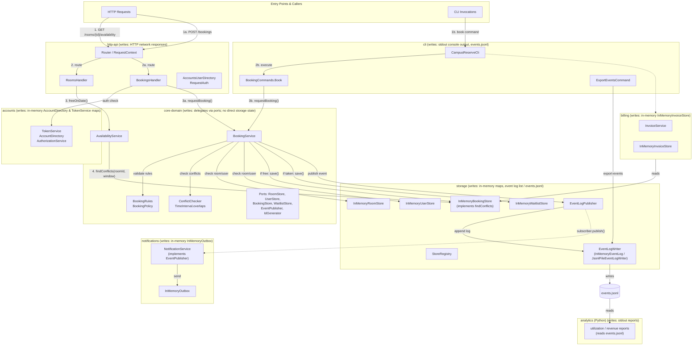

# BOUNDARIES.md

One section per milestone. Fill them in in order (the sketch before you write
anything about it, the copies next, the proposal last).

Draw Milestone 1's sketch from the code. A TA may ask where each arrow came
from.

Keep it short and specific. Point at modules, files, and callers.

---

## Milestone 1: The architecture as built

**The sketch.**

**What each module writes:**
- `core-domain`: Holds no persistent state; delegates all state writes to ports (`BookingStore.save`, `WaitlistStore.save/remove`, `EventPublisher.publish`).
- `storage`: Writes to in-memory store maps (`InMemoryBookingStore`, `InMemoryWaitlistStore`, `InMemoryRoomStore`, `InMemoryUserStore`), appends to in-memory event list (`InMemoryEventLog`) or writes lines to `events.jsonl` (`JsonlFileEventLogWriter`).
- `notifications`: Writes queued notification records to `InMemoryOutbox`.
- `accounts`: Writes in-memory account and token maps in `AccountDirectory` and `TokenService`; syncs accounts into domain `UserStore`.
- `billing`: Writes generated invoice records to in-memory map in `InMemoryInvoiceStore`.
- `http-api`: Writes HTTP network responses to socket (no persistent data store).
- `cli`: Writes formatted text to stdout; `ExportEventsCommand` writes `events.jsonl` to disk.
- `analytics`: Reads `events.jsonl`; writes formatted reports to stdout (does not write persistent stores or events).

**Where your sketch and `ARCHITECTURE.md` disagree.**
1. `ARCHITECTURE.md` completely omits the availability request path (`GET /rooms/{roomId}/availability`) and `AvailabilityService`, whereas our sketch charts it from `RoomsHandler` through `AvailabilityService` to `BookingStore.findConflicts`.
2. `ARCHITECTURE.md` asserts that all conflict checking routes through `ConflictChecker ---> TimeInterval.overlaps` ("the only overlap implementation"), whereas our sketch shows a second overlap predicate implemented directly inside `storage`'s `InMemoryBookingStore.findConflicts`.
3. `ARCHITECTURE.md` draws a direct dependency arrow from `EventLogPublisher (storage)` to `NotificationService (outbox)`, whereas our sketch shows `storage` decoupled from `notifications` (dispatched via the `EventPublisher` port wired inside `http-api`).

**How you decided which one is right.**
1. **Availability path**: In `http-api/src/main/java/edu/cmu/cs214/campusreserve/http/RoomsHandler.java` (lines 38, 71–93), `router.get("/rooms/{roomId}/availability", ...)` routes availability requests to `RoomsHandler.availability`, which calls `AvailabilityService.freeOnDate` (`core-domain/src/main/java/edu/cmu/cs214/campusreserve/core/service/AvailabilityService.java`, line 41), which queries `BookingStore.findConflicts`. Wiring is verified in `http-api/src/main/java/edu/cmu/cs214/campusreserve/http/CampusReservePlatform.java` (lines 50, 156).
2. **Second conflict predicate**: In `storage/src/main/java/edu/cmu/cs214/campusreserve/storage/InMemoryBookingStore.java` (lines 55–64), `findConflicts` compares interval bounds directly (`booking.interval().start().isBefore(windowEnd) && windowStart.isBefore(booking.interval().end())`) without calling `TimeInterval.overlaps` or `ConflictChecker`. This second predicate is explicitly pinned by unit tests in `storage/src/test/java/edu/cmu/cs214/campusreserve/storage/FindConflictsTest.java`.
3. **Decoupled notification subscriber**: `storage/pom.xml` has no dependency on `notifications`. In `storage/src/main/java/edu/cmu/cs214/campusreserve/storage/EventLogPublisher.java` (lines 22, 39–45), `EventLogPublisher` references only a generic `List<EventPublisher>` (from `core-domain/src/main/java/edu/cmu/cs214/campusreserve/core/ports/EventPublisher.java`). The subscriber connection to `NotificationService` is wired exclusively in `http-api/src/main/java/edu/cmu/cs214/campusreserve/http/CampusReservePlatform.java` (line 58: `stores.subscribe(notifications);`).

---

## Milestone 2: Run it as copies

**Your stack.** The command that brought the stack up with two copies, and how
many distinct `X-Upstream` values your runs saw.

### Finding 1: tokens

**The claim.** One sentence, the one your script checks.

**The script and its result.** The file in `load/`, its threshold, and what a
run printed.

**Why, from the code.** The class that keeps tokens and how it is wired into
each copy. Say how you found it.

**The kind of problem.** Use the vocabulary from lecture.

### Finding 2: bookings

**The claim.**

**The script and its result.** Say how it reaches each copy directly, and why
it has to.

**Why, from the code.**

**The kind of problem.**

### What you checked

One thing your agent proposed that you checked (what it proposed, how you
checked it, and what came of it).

---

## Milestone 3: One boundary

Take one problem from Milestone 1 or 2 and propose the boundary that fixes it.

**The boundary.** The port, what it promises, and which side implements it. Say what
moves and what stays.

**Who owns the data.** Name the module that owns the data this boundary is about,
and say what everybody else is allowed to do with it.

**The one invariant that must not cross.** Exactly one, stated so that a reader
can tell whether a given piece of code violates it.

**What the boundary costs.** An interface to keep, a second implementation to
maintain, a performance argument to have again. Include what it leaves unfixed.

Feel free to read the appendix on what a good proposal looks like in the Lab 3 handout
before you write this section.
